# Lady Go — Database ERD

Status: Phase 2 · generated from the migrated schema (Flyway V1–V11) on PostgreSQL 16 + PostGIS 3.

The diagrams below are generated from a live database after applying every migration, so they match the schema exactly. Narrative design, conventions and retention are in [database-design.md](database-design.md). The migrations in `backend/src/main/resources/db/migration` are the source of truth.

Legend: `PK` primary key, `FK` foreign key. `geography` columns are PostGIS `geography(…, 4326)`. Money is `int8` in minor units. Enumerations are `varchar` with CHECK constraints (mirrored by Java enums and verified by `EnumSchemaParityTest`).

## 1. Relationships

```mermaid
erDiagram
    bookings ||--o{ booking_events : "booking_id"
    bookings ||--o{ payment_transactions : "booking_id"
    bookings ||--o{ ride_offers : "booking_id"
    bookings ||--o{ rides : "booking_id"
    cities ||--o{ bookings : "city_id"
    cities ||--o{ configuration : "city_id"
    cities ||--o{ customers : "default_city_id"
    cities ||--o{ drivers : "city_id"
    cities ||--o{ pricing_rules : "city_id"
    customers ||--o{ bookings : "customer_id"
    customers ||--o{ emergency_contacts : "customer_id"
    customers ||--o{ payment_methods : "customer_id"
    customers ||--o{ payment_transactions : "customer_id"
    customers ||--o{ rides : "customer_id"
    customers ||--o{ saved_locations : "customer_id"
    drivers ||--o{ bookings : "driver_id"
    drivers ||--o{ driver_documents : "driver_id"
    drivers ||--o{ location_history : "driver_id"
    drivers ||--o{ location_history_2026_09 : "driver_id"
    drivers ||--o{ location_history_2026_10 : "driver_id"
    drivers ||--o{ location_history_2026_11 : "driver_id"
    drivers ||--o{ location_history_2026_12 : "driver_id"
    drivers ||--o{ location_history_2027_01 : "driver_id"
    drivers ||--o{ location_history_default : "driver_id"
    drivers ||--o{ ride_offers : "driver_id"
    drivers ||--o{ rides : "driver_id"
    drivers ||--o{ vehicles : "driver_id"
    payment_transactions ||--o{ refunds : "transaction_id"
    pricing_rules ||--o{ bookings : "pricing_rule_id"
    refresh_tokens ||--o{ refresh_tokens : "replaced_by"
    rides ||--o{ location_history : "ride_id"
    rides ||--o{ location_history_2026_09 : "ride_id"
    rides ||--o{ location_history_2026_10 : "ride_id"
    rides ||--o{ location_history_2026_11 : "ride_id"
    rides ||--o{ location_history_2026_12 : "ride_id"
    rides ||--o{ location_history_2027_01 : "ride_id"
    rides ||--o{ location_history_default : "ride_id"
    rides ||--o{ ratings : "ride_id"
    rides ||--o{ safety_incidents : "ride_id"
    rides ||--o{ trip_shares : "ride_id"
    safety_incidents ||--o{ safety_incident_events : "incident_id"
    users ||--o{ configuration : "updated_by"
    users ||--o{ customers : "user_id"
    users ||--o{ device_tokens : "user_id"
    users ||--o{ driver_documents : "reviewer_id"
    users ||--o{ drivers : "user_id"
    users ||--o{ notification_logs : "user_id"
    users ||--o{ pricing_rules : "created_by"
    users ||--o{ ratings : "ratee_id"
    users ||--o{ refresh_tokens : "user_id"
    users ||--o{ refunds : "created_by"
    users ||--o{ safety_incident_events : "actor_id"
    users ||--o{ safety_incidents : "acknowledged_by"
    users ||--o{ trip_shares : "created_by"
    vehicles ||--o{ driver_documents : "vehicle_id"
```

Notes: `bookings 1—1 rides` and `customers 1—1 users` are one-to-one via UNIQUE constraints (drawn above as one-to-many by the generator). `location_history` is a monthly range-partitioned table; its foreign keys point at `rides` and `drivers`. `audit_logs` deliberately has no foreign keys, so audit rows outlive what they describe.

## 2. Reference and configuration

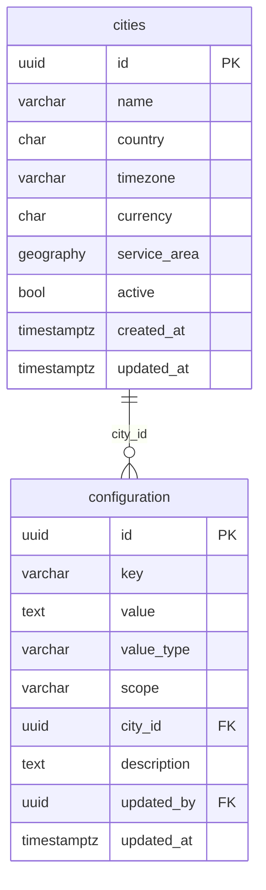

## 3. Identity and authentication

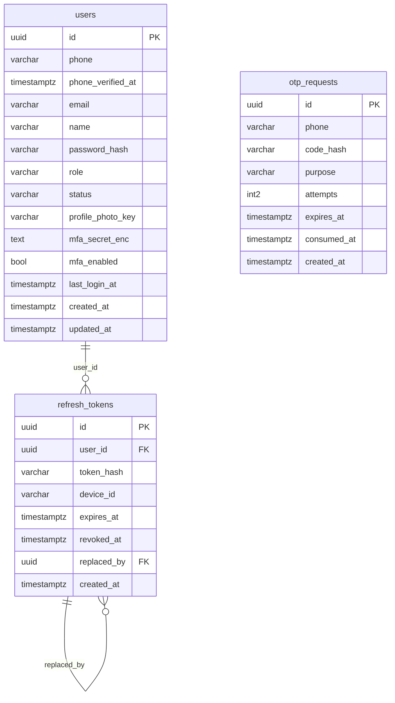

## 4. Customers

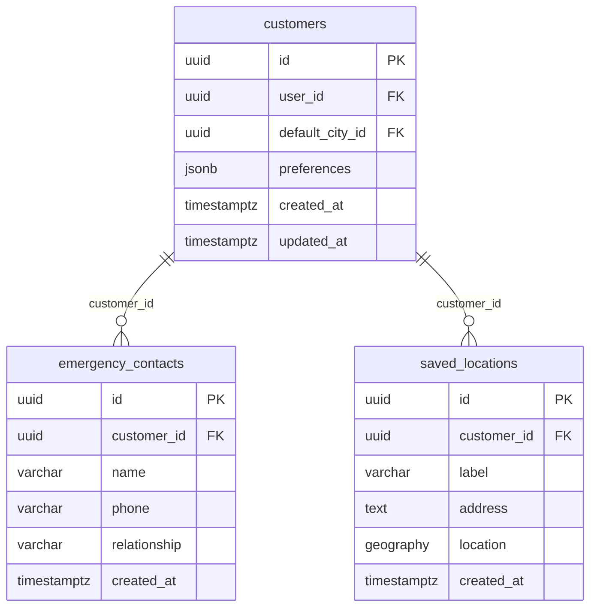

## 5. Drivers and vehicles

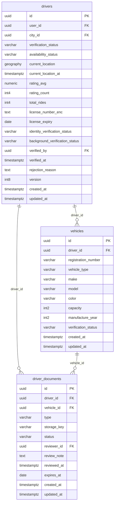

## 6. Pricing

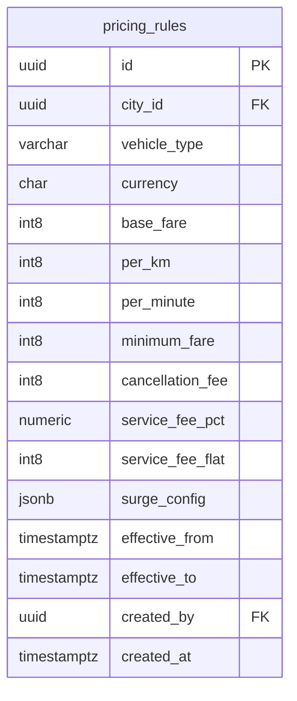

## 7. Bookings and matching

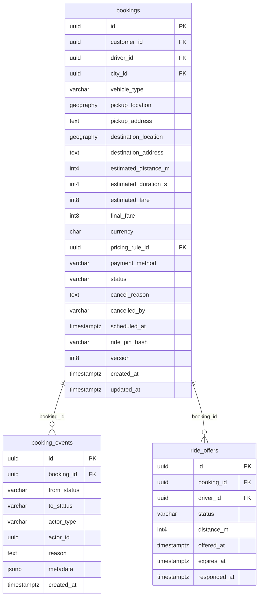

## 8. Rides and tracking

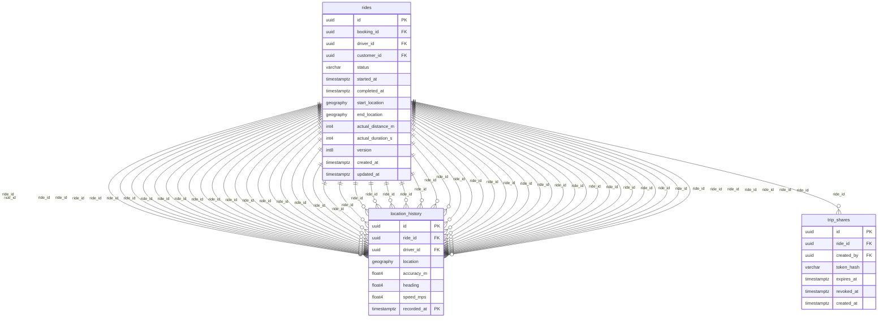

## 9. Payments

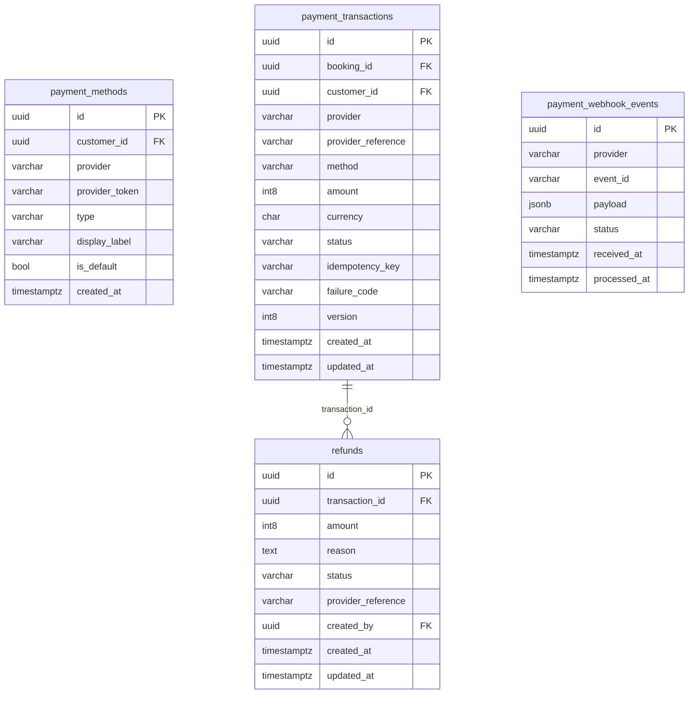

## 10. Ratings and safety

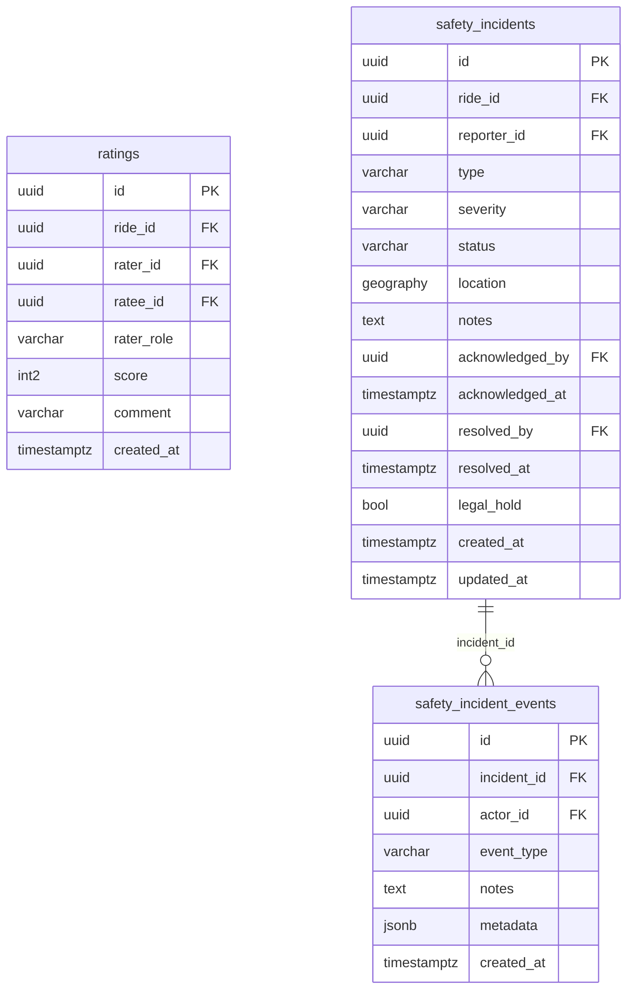

## 11. Notifications and audit

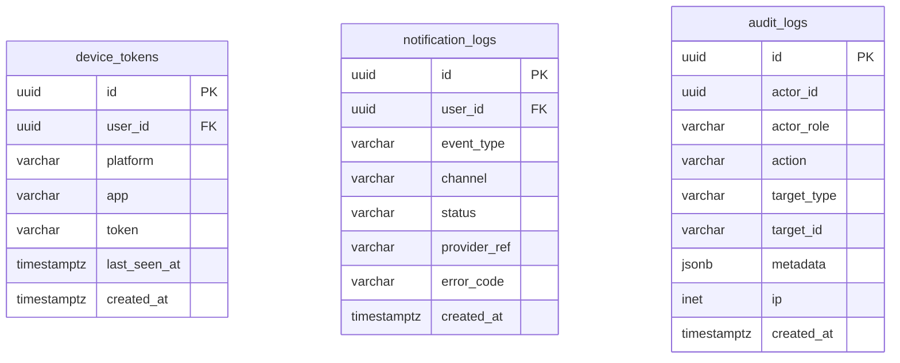

## Invariants enforced by the database

These hold even if application code has a bug or two workers race. Each is covered by a test in `DatabaseConstraintsTest`.

| Rule | Mechanism |
|------|-----------|
| Phone numbers are E.164 and unique | CHECK + UNIQUE on `users.phone` |
| Only admin roles may have a password hash or MFA secret | CHECK on `users` |
| E-mail is unique ignoring case | unique index on `lower(email)` |
| A driver can only be ONLINE / BUSY / ON_RIDE if verification is APPROVED | CHECK `ck_drivers_online_requires_approval` |
| A driver holds at most one committed booking | partial unique index `uq_bookings_one_active_per_driver` |
| A booking is accepted by exactly one driver | partial unique index `uq_ride_offers_one_accepted` |
| A CANCELLED booking records who cancelled it | CHECK `ck_bookings_cancelled` |
| At most one pricing rule applies per city and vehicle type at any moment | exclusion constraint on `tstzrange(effective_from, effective_to)` |
| Payment requests are idempotent; provider webhooks are processed once | UNIQUE `idempotency_key`; UNIQUE `(provider, event_id)` |
| One rating per rater per ride; scores 1–5; no self-rating | UNIQUE + CHECKs on `ratings` |
| Event and audit history cannot be edited | `BEFORE UPDATE` trigger raising an error on `booking_events`, `safety_incident_events`, `audit_logs` |
| Location trails exist only per ride, in monthly partitions | partitioned `location_history` + default partition; `create_location_history_partition(date)` |
| Global configuration keys are unique | unique index on `(key, scope, coalesce(city_id, …))` |

## Operational notes

- **Partitions:** migration V7 creates partitions for the previous month through the next three. A scheduled job (Phase 12) must call `create_location_history_partition(next_month)` ahead of time; until then rows fall into `location_history_default`, which is a safety net, not a place to leave data (a partition cannot be created over a range that already has rows in the default partition).
- **Retention:** 90-day location history is enforced by dropping old partitions; rides with `safety_incidents.legal_hold = true` must be exempted by the retention job (Phase 10/12).
- **No JPA entity for `location_history`:** it is high-volume and append-only, so Phase 7 writes it with JDBC batch inserts.
- **Cross-module references are plain UUIDs** in the Java entities (not `@ManyToOne`), keeping modules decoupled; the foreign keys still exist in the database.
- **Encrypted columns** (`license_number_enc`, `mfa_secret_enc`) hold application-level ciphertext; key management arrives with Phase 3/5.
- **Dev seed:** `db/dev/R__dev_seed_city.sql` adds a placeholder Srinagar city and is loaded only by the `dev` profile.
